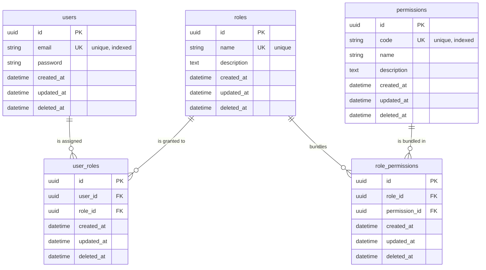

# ERD: Authentication & Authorization (Authz)

**Status:** Proposed
**Related ADR:** [ADR 0003](../adr/0003-auth-persistence-schema.md)
**Scope:** Persistence foundation for authentication and role-based authorization
**Database Targets:** SQLite (local development) / PostgreSQL (production)

---

## 1. Purpose

This document describes the persistence schema and entity relationships for the
authentication and role-based access control (RBAC) foundation of the AirPart ERP
backend. It covers the five core tables required by the acceptance criteria:

`users`, `roles`, `permissions`, `user_roles`, and `role_permissions`.

The schema is defined exclusively through the Django ORM, so migrations remain
portable between SQLite and PostgreSQL without hand-written DDL.

## 2. Entity Relationship Diagram



## 3. Table Definitions

### 3.1 `users`

Represents an authenticated principal. Bound to the project's custom user model
by referencing `settings.AUTH_USER_MODEL` rather than importing a concrete class.

| Column       | Type      | Constraints        | Notes                                    |
| ------------ | --------- | ------------------ | ---------------------------------------- |
| `id`         | UUID      | Primary key        | Non-sequential, safe for public exposure |
| `email`      | VARCHAR   | Unique, indexed    | Login identifier                         |
| `password`   | VARCHAR   | Not null           | Stored as a Django password hash         |
| `created_at` | TIMESTAMP | Auto-set on insert | Audit column                             |
| `updated_at` | TIMESTAMP | Auto-set on update | Audit column                             |
| `deleted_at` | TIMESTAMP | Nullable, indexed  | Soft-delete marker                       |

### 3.2 `roles`

A named, reusable collection of permissions.

| Column        | Type      | Constraints        | Notes                              |
| ------------- | --------- | ------------------ | ---------------------------------- |
| `id`          | UUID      | Primary key        |                                    |
| `name`        | VARCHAR   | Unique, not null   | e.g. `SUPER_ADMIN`, `SALES_REP`    |
| `description` | TEXT      | Nullable           | Human-readable purpose of the role |
| `created_at`  | TIMESTAMP | Auto-set on insert | Audit column                       |
| `updated_at`  | TIMESTAMP | Auto-set on update | Audit column                       |
| `deleted_at`  | TIMESTAMP | Nullable, indexed  | Soft-delete marker                 |

### 3.3 `permissions`

An atomic, granular capability expressed as a colon-delimited code.

| Column        | Type      | Constraints               | Notes                                 |
| ------------- | --------- | ------------------------- | ------------------------------------- |
| `id`          | UUID      | Primary key               |                                       |
| `code`        | VARCHAR   | Unique, indexed, not null | e.g. `parts:create`, `invoice:read`   |
| `name`        | VARCHAR   | Not null                  | Display name                          |
| `description` | TEXT      | Nullable                  | Explanation of the granted capability |
| `created_at`  | TIMESTAMP | Auto-set on insert        | Audit column                          |
| `updated_at`  | TIMESTAMP | Auto-set on update        | Audit column                          |
| `deleted_at`  | TIMESTAMP | Nullable, indexed         | Soft-delete marker                    |

### 3.4 `user_roles` (junction)

Assignment of a role to a user. Modeled explicitly instead of using Django's
implicit `ManyToManyField`, so audit columns and constraints stay under our control.

| Column       | Type      | Constraints              | Notes              |
| ------------ | --------- | ------------------------ | ------------------ |
| `id`         | UUID      | Primary key              |                    |
| `user_id`    | UUID      | FK → `users.id`, CASCADE |                    |
| `role_id`    | UUID      | FK → `roles.id`, CASCADE |                    |
| `created_at` | TIMESTAMP | Auto-set on insert       | Audit column       |
| `updated_at` | TIMESTAMP | Auto-set on update       | Audit column       |
| `deleted_at` | TIMESTAMP | Nullable, indexed        | Soft-delete marker |

### 3.5 `role_permissions` (junction)

Grant of a permission to a role. Also modeled explicitly.

| Column          | Type      | Constraints                    | Notes              |
| --------------- | --------- | ------------------------------ | ------------------ |
| `id`            | UUID      | Primary key                    |                    |
| `role_id`       | UUID      | FK → `roles.id`, CASCADE       |                    |
| `permission_id` | UUID      | FK → `permissions.id`, CASCADE |                    |
| `created_at`    | TIMESTAMP | Auto-set on insert             | Audit column       |
| `updated_at`    | TIMESTAMP | Auto-set on update             | Audit column       |
| `deleted_at`    | TIMESTAMP | Nullable, indexed              | Soft-delete marker |

---

## 4. Relationship Summary

| Left Entity   | Cardinality | Right Entity  | Junction Table     | Semantics                         |
| ------------- | ----------- | ------------- | ------------------ | --------------------------------- |
| `users`       | 1 → N       | `roles`       | `user_roles`       | A user may hold many roles        |
| `roles`       | N → 1       | `users`       | `user_roles`       | A role may be held by many users  |
| `roles`       | 1 → N       | `permissions` | `role_permissions` | A role bundles many permissions   |
| `permissions` | N → 1       | `roles`       | `role_permissions` | A permission may be in many roles |

Both relationships are **many-to-many**, resolved through explicit through-models.

---

## 5. Constraint Summary

| Table              | Constraint Name          | Type               | Columns                    | Rationale                                     |
| ------------------ | ------------------------ | ------------------ | -------------------------- | --------------------------------------------- |
| `users`            | `users_email_key`        | Unique             | `email`                    | Prevents duplicate accounts                   |
| `roles`            | `roles_name_key`         | Unique             | `name`                     | A role name must resolve to exactly one role  |
| `permissions`      | `permissions_code_key`   | Unique             | `code`                     | Permission codes must be globally unambiguous |
| `user_roles`       | `unique_user_role`       | Unique (composite) | `user_id`, `role_id`       | Blocks duplicate role assignments             |
| `role_permissions` | `unique_role_permission` | Unique (composite) | `role_id`, `permission_id` | Blocks duplicate permission grants to a role  |

Composite uniqueness is enforced at the **database level**, not only in application
code, so concurrent writes cannot create duplicates.

---

## 6. Audit Columns

Every table above inherits from the abstract base model `TimeStampedAuditModel`,
which guarantees:

- `created_at` — set once on insert, indexed for range filtering.
- `updated_at` — refreshed on every save.
- `deleted_at` — `NULL` while active; populated by `soft_delete()` instead of a
  physical `DELETE`, preserving referential history for audit purposes.

Uniform inheritance removes the risk of a table drifting from the audit standard.

---

## 7. Portability Notes (SQLite / PostgreSQL)

- All identifiers are UUIDs, so no auto-increment sequence behavior is relied upon.
- No database-specific types, functions, or raw SQL are used.
- Constraint names are explicit, keeping migration history identical across engines.
- Development runs on SQLite; production targets PostgreSQL; a single migration
  history serves both.

---

## 8. Multi-Tenancy Consideration (Documented, Not Implemented)

A future `tenant_id` column will be required on `roles`, `permissions`, and the
junction tables to support per-tenant isolation. This document records the
consideration only. **No tenancy enforcement is implemented at this stage**, per
the current project decision; any `tenant_id` work must be introduced through a
new ADR before code changes.

---

## 9. Out of Scope

- Permission enforcement / policy evaluation logic.
- Seeding production or tenant-specific data.
- User registration and login flows.
- Multi-tenancy enforcement.

---

## 10. References

- ADR 0003 — Auth persistence schema
- `app/authz/models.py`
- `app/authz/migrations/0001_initial.py`
- `app/authz/management/commands/seed_authz.py`
- `app/tests/test_authz.py`

```

```

```

```
